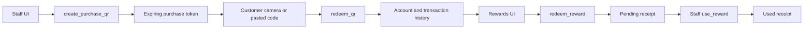

# Architecture and extraction boundaries

## User story

A staff member creates a purchase QR; a customer claims points, exchanges them for a reward, and presents a receipt that staff validates once.

## Responsibility boundaries

The Expo client owns session persistence, navigation, input feedback, camera permissions, and presentation. Theme tokens and shared components preserve a consistent visual language. Menu content comes from database rows.

The client uses the public API key and the user's session. PostgreSQL owns authorization, point calculation, balances, token consumption, and reward transitions. Protected routes improve navigation; they are not the data authorization boundary. Staff membership comes from `staff_members`, not editable user metadata.

| Operation | Transactional behavior |
| --- | --- |
| `create_purchase_qr` | Checks active staff membership and derives points and expiration from backend settings. |
| `redeem_qr` | Locks the token, checks expiry/prior use, updates the account, writes a transaction, and claims the token atomically. |
| `redeem_reward` | Locks the account before checking balance, debits points, writes history, and creates the receipt atomically. |
| `use_reward` | Checks active staff membership, locks the receipt, and rejects repeated/cancelled validations. |

The camera callback also uses a synchronous `useRef` lock to suppress accidental duplicate submissions. Independent clients can still compete, so correctness depends on database locks/checks. Integration tests exercise that boundary with concurrent RPC calls.

## Data included

- `profiles`, `staff_members`: identity and role lookup.
- `loyalty_accounts`, `point_transactions`: balances and movement history.
- `qr_tokens`: expiring purchase claims.
- `rewards`, `reward_redemptions`: reward catalog and receipt lifecycle.
- `categories`, `products`, `loyalty_settings`: menu content and demo point settings.

All three migrations are preserved byte-for-byte. The complete chain is required: the later `add_points` permission change must not be omitted when reviewing the baseline. No new RLS, grants, or privileged SQL functions were added for this extraction.

## Changes for the showcase

- Independent repository history, Expo identity, and URL scheme.
- Local project `estero10-loyalty-showcase` on ports `55320–55329`, separate from the original local stack.
- Fictional SQL catalog and script-created Auth fixtures; no remote data dump or existing environment files.
- App endpoint guard for loopback/private LAN hosts on port `55321`; privileged tooling allows loopback only.
- Optional pasted codes and selectable purchase tokens. Pasted values follow the same UUID validation and RPC path as camera results.
- Demo label on the login screen; original theme and imported UI components retained. Demo menu currency matches purchase generation in quetzales.
- Setup/test wrappers capture ephemeral privileged keys without writing them into the app or CI logs.
- CI for app checks, local migrations, and integration tests; no deploy job or hosted connection.

## Deliberate limits

This extraction preserves existing authorization behavior. The inherited SQL includes privileged functions with explicit caller checks and an empty search path. Broader default-privilege hardening, staff abuse quotas/attribution, and operational deployment policy remain separate review work.

Menu items intentionally use branded image fallbacks: no restaurant product photos or external image services are included. The product card retains `image_url` support and image error handling. Logo/app artwork comes from the source project; this extraction adds no redistribution license.

Payments, ordering, delivery, offline mutations, and a hosted demo are outside scope. README claims describe included code and tests, not production usage or business outcomes.
